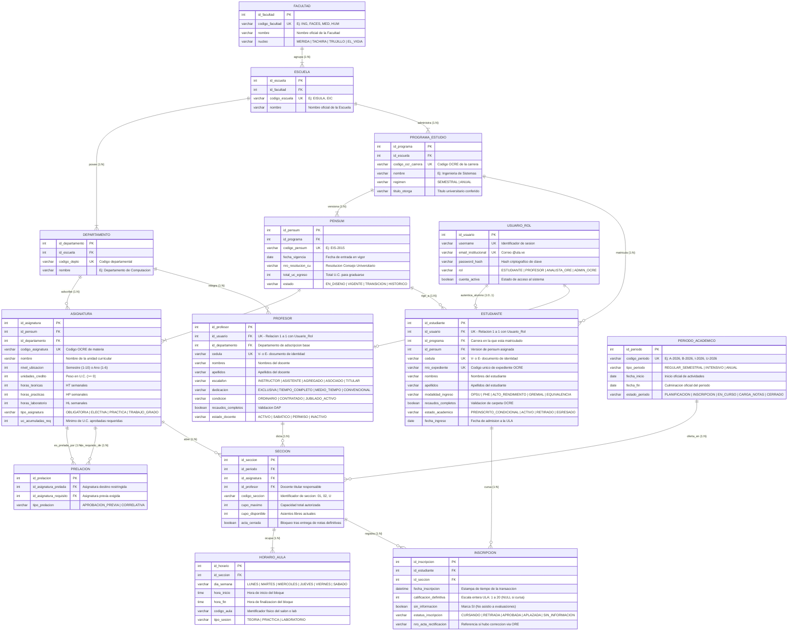

# Conceptualizacion del Sistema de Registros Estudiantiles
## Componente A: Recaudos y Procedimientos de ingreso
### Estudiantes 
#### Recaudos Exigidos
* **Cédula de Identidad** vigente (original y copia ampliada) o **Pasaporte** con visa estudiantil para extranjeros.
* **Título de Bachiller** en original y fondo negro autenticado por el plantel de origen y la Zona Educativa.
* **Certificación de Calificaciones de Educación Media** (1.º a 5.º/6.º año) en original y fondo negro autenticado.
* **Constancia de Registro o Asignación OPSU** (Sistema Nacional de Ingreso - SNI).
* **Planilla de derecho a matricula**
* **Planilla de Admisión Oficial OCRE**, según la modalidad de ingreso aprobada:
  * Asignación OPSU-SNI.
  * Prueba de Habilidades Específicas (PHE-ULA).
  * Políticas de Admisión Especial (Alto Rendimiento, Atletas de Alta Competencia, Artistas de Destacada Trayectoria).
  * Convenios Gremiales (APULA, AEULA, SIPRULA, Sagem).
  * Procesos Internos (Cambio de Opción, Carreras Simultáneas, Equivalencia de Estudios o Reincorporación).
* **Partida de Nacimiento** original y legible.
* **Inscripción Militar** (obligatorio para venezolanos mayores de 18 años).
* **3 Fotografía digital tipo carnet** (fondo blanco, formato JPG/PNG para expediente y carnetización).
#### Validaciones del Sistema
* **Unicidad de Identidad:** El número de documento (`V-` o `E-`) es único en la tabla `Estudiante`. Un estudiante no puede tener dos expedientes con estatus `ACTIVO` en el mismo programa de estudio.
* **Autorización de Cohorte:** La cédula del aspirante debe existir previamente en el lote oficial de admitidos cargado por OCRE para el `Periodo_Academico` de ingreso y el `Programa_Estudio` correspondiente.
#### Procedimiento de Ingreso
1. **Importación de Admitidos:** El Administrador de OCRE carga en el sistema el listado oficial de aspirantes admitidos en el período académico, indicando cédula, carrera asignada y modalidad de ingreso.
2. **Preinscripción Web:** El aspirante ingresa al portal con su cédula, completa su ficha socioeconómica y de contacto, y sube su fotografía digital, generando la Planilla de Cita de Consignación.
3. **Verificación y Cotejo en Taquilla (OCRE):** El analista de OCRE recibe la carpeta física, coteja los originales contra el sistema y marca en el checklist digital cada recaudo entregado.
4. **Activación de Expediente y Asignación Curricular:** Al validarse los recaudos mínimos, el sistema:
   * Crea el usuario institucional con rol `ESTUDIANTE` en `Usuario_Rol`.
   * Genera el código único de expediente estudiantil (`nro_expediente`).
   * Asigna automáticamente el `Pensum` con estatus `VIGENTE` para ese `Programa_Estudio`.
   * Actualiza el estado académico del estudiante a `ACTIVO`.
5. **Matriculación Inicial:** El sistema inscribe al estudiante de nuevo ingreso en las secciones disponibles de las asignaturas correspondientes al **Semestre 1 / Año 1** de su pensum.
6. **Emisión de Comprobante:** Se genera el Comprobante Oficial de Inscripción en formato PDF con código de validación institucional.
### Profesores 
#### Recaudos Exigidos
* **Cédula de Identidad** vigente y **RIF** actualizado.
* **Títulos Universitarios de Pregrado y Postgrado** (Especialización, Maestría o Doctorado) debidamente registrados y en fondo negro autenticado.
* **Acta Veredicto de Concurso de Oposición** (para ingreso como personal docente Ordinario) o **Resolución de Concurso de Credenciales / Contratación** (para personal Contratado).
* **Resolución de Nombramiento** emitida por el Consejo de Facultad y ratificada por el Consejo Universitario.
* **Planilla de Movimiento de Personal (FP-020)** visada por la Dirección de Asuntos Profesorales (DAP).
* **Declaración Jurada de Dedicación y No Incompatibilidad Horaria**, conforme a la Ley de Universidades.
* **Síntesis Curricular** con soportes de méritos académicos y científicos.
#### Validaciones del Sistema
* **Unicidad y Adscripción Obligatoria:** La cédula del docente debe ser única y todo profesor debe estar adscrito obligatoriamente a un único `Departamento` base dentro de una `Escuela`, sin perjuicio de que pueda dictar secciones de asignaturas adscritas a otros departamentos.
* **Dominio de Escalafón y Condición:** El profesor debe clasificarse estrictamente en una condición (`ORDINARIO`, `CONTRATADO`, `JUBILADO_ACTIVO`) y una categoría del escalafón universitario (`AUXILIAR_DOCENTE`, `INSTRUCTOR`, `ASISTENTE`, `AGREGADO`, `ASOCIADO`, `TITULAR`).
* **Restricción de Carga Horaria por Dedicación:** El régimen de dedicación registrado controla el límite máximo de horas semanales de docencia directa (secciones) que el sistema permite asignarle en un período:
  * `EXCLUSIVA` o `TIEMPO_COMPLETO`: Habilitado para carga docente completa (12 a 16 horas de aula/semana).
  * `MEDIO_TIEMPO`: Límite máximo de 6 a 10 horas de aula/semana.
  * `TIEMPO_CONVENCIONAL`: Límite estricto según horas contratadas (2 a 12 horas/semana).
#### Procedimiento de Ingreso
1. **Solicitud Departamental:** El Jefe de Departamento registra en el sistema los datos básicos del docente seleccionado tras el cierre del concurso o solicitud de contratación.
2. **Validación Legal y Administrativa (Direccion de Asuntos Profesorales):** El analista administrativo verifica los títulos, carga el número y fecha de la Resolución del Consejo de Facultad/Universitario y marca como completado el checklist de recaudos.
3. **Configuración de Perfil Académico:** Se asigna formalmente el `Departamento` de adscripción, la condición laboral, la categoría en el escalafón y el régimen de dedicación.
4. **Activación y Asignación de Rol:** El sistema crea las credenciales institucionales del docente en `Usuario_Rol` con el perfil `PROFESOR` y cambia su estatus a `ACTIVO`, habilitándolo en el catálogo del departamento para ser asignado a la apertura de secciones (`Seccion`).
### Pensum 
#### Recaudos Exigidos
* **Proyecto de Creación o Reforma Curricular** elaborado y firmado por la Comisión Curricular de la Escuela y avalado por la Comisión Curricular Central de la ULA.
* **Acta de Aprobación del Consejo de Facultad** respectivo.
* **Resolución Oficial del Consejo Universitario de la ULA** que aprueba el programa o la reforma del pensum (indicando número de resolución y período académico de entrada en vigencia).
* **Certificación de Aprobación del Consejo Nacional de Universidades (CNU)** y referencia de publicación en Gaceta Oficial (obligatorio para creación de nuevas carreras o cambio de título otorgado).
* **Matriz Curricular Oficial (Documento Maestro del Pensum):** Especificación detallada de cada asignatura (código OCRE, nombre, semestre o año de ubicación, Unidades de Crédito `U.C.`, Horas Teóricas `HT`, Horas Prácticas `HP`, Horas de Laboratorio `HL`, carácter `OBLIGATORIA | ELECTIVA | TRABAJO_GRADO`, departamento responsable y tabla de prelaciones).

#### Validaciones del Sistema
* **Jerarquía Organizacional:** Todo `Programa_Estudio` debe pertenecer a una `Escuela` existente, la cual a su vez pertenece a una `Facultad`. Toda `Asignatura` del pensum debe estar administrada por un `Departamento` válido.
* **Consistencia de Créditos:** El requisito de Unidades de Crédito acumuladas (`uc_acumuladas_req`) exigido para inscribir una asignatura avanzada (ej. Servicio Comunitario o Proyecto de Grado) no puede exceder la sumatoria total de U.C. de los niveles anteriores del mismo pensum.
* **Versionado e Inmutabilidad Histórica:** Un `Pensum` que ya posee estudiantes matriculados o registros en `Inscripcion` es **inmutable** en su estructura de créditos y códigos; cualquier modificación curricular obliga a crear una nueva versión de `Pensum` asociada al mismo `Programa_Estudio`.

#### Procedimiento de Ingreso
1. **Alta del Programa de Estudio (Carrera):** El Administrador de OCRE selecciona la `Facultad` y la `Escuela`, y registra el `Programa_Estudio` (código OCRE, nombre de la carrera, régimen `SEMESTRAL` o `ANUAL`, título a otorgar y escala de calificación vigente de 1 a 20 puntos, nota mínima aprobatoria 10 puntos).
2. **Creación de Versión de Pensum:** Se registra una nueva instancia en la entidad `Pensum` vinculada a la carrera, con estado inicial `EN_DISEÑO`, indicando el código del plan (ej. `PENSUM-2026`), fecha de vigencia, número de Resolución del Consejo Universitario y total de U.C. requeridas para egreso.
3. **Carga del Catálogo de Asignaturas:** Se registran e incorporan al pensum todas las asignaturas con su código único, departamento de adscripción, ubicación semestral, peso en Unidades de Crédito (`U.C.`), desglose horario semanal (`HT`, `HP`, `HL`), tipo de asignatura y requisito de U.C. acumuladas.

## Componente B: Levantamiento de Requerimientos Funcionales bajo Múltiples Metodologías

Este componente formaliza las capacidades funcionales del sistema **ULA-SIRE** combinando la captura ágil mediante **Historias de Usuario (HU)** con su especificación técnica equivalente bajo el estándar **IEEE 830 (RF)** y la estructura de **Casos de Uso UML (CU)**. Adicionalmente, analiza alternativas técnicas de implementación para los procesos críticos y establece la trazabilidad hacia el Modelo ER y los avances del semestre.

---

### 1. Especificación de Requerimientos Funcionales por Módulo

#### Módulo 1: Gestión de Estructura Académica (Facultad / Escuela / Pensum)

* **Historia de Usuario (`HU-01`):**
  > **Como** Administrador de OCRE, **quiero** registrar y gestionar facultades, escuelas, departamentos, programas de estudio, versiones de pensum, asignaturas y sus prelaciones, **para** mantener actualizada la estructura curricular oficial de la ULA sin alterar el historial de cohortes anteriores.
  * *Criterios de Aceptación:* No se permite eliminar un pensum con estudiantes inscritos; el sistema debe rechazar prelaciones circulares ($A \to B \to A$) y autoprelaciones. No permitir códigos de materias duplicados

* **Especificación Formal IEEE 830 (`RF-01`) / Caso de Uso (`CU-01: Gestionar Estructura Curricular`):**
  * **Actor Principal:** Administrador OCRE (`ADMIN_OCRE`).
  * **Precondiciones:** Usuario autenticado con rol `ADMIN_OCRE`; resolución aprobatoria del Consejo Universitario disponible.
  * **Entradas:** Datos de `Facultad`, `Escuela`, `Departamento`, `Programa_Estudio`, `Pensum` (resolución, vigencia, total U.C.), `Asignatura` (código, U.C., HT/HP/HL, semestre, U.C. requeridas) y `Prelacion` (asignatura requisito, tipo).
  * **Flujo Normal (Proceso):**
    1. El sistema valida la jerarquía organizacional (`Facultad` $\to$ `Escuela` $\to$ `Programa_Estudio` $\to$ `Pensum`).
    2. Registra las asignaturas vinculándolas a su `Pensum` y `Departamento` responsable.
    3. Al cargar prelaciones, ejecuta un algoritmo de detección de ciclos y verifica que el nivel de la asignatura requisito sea inferior al de la prelada.
    4. Cambia el estado del pensum de `EN_DISENO` a `VIGENTE`.
  * **Flujo de Excepción:** Si se detecta un ciclo en las prelaciones o un código de asignatura duplicado, el sistema cancela la operación y muestra el conflicto exacto.
  * **Salidas / Postcondiciones:** Estructura curricular persistida y habilitada para matriculación y apertura de oferta académica.

---

#### Módulo 2: Registro de Estudiantes y Profesores

* **Historia de Usuario (`HU-02`):**
  > **Como** Analista de OCRE, **quiero** registrar estudiantes admitidos y profesores incorporados validando su identidad, recaudos y rol de acceso, **para** activar sus expedientes académicos y habilitarlos en el período en curso.
  * *Criterios de Aceptación:* La cédula debe ser única por perfil; todo estudiante debe quedar vinculado a un pensum vigente y todo profesor a un departamento, escalafón y dedicación válidos.

* **Especificación Formal IEEE 830 (`RF-02`) / Caso de Uso (`CU-02: Registrar Expediente Estudiantil y Docente`):**
  * **Actor Principal:** Analista OCRE (Estudiantes) /  (Profesores).
  * **Precondiciones:** Existen las carreras, pensum vigentes y departamentos; el aspirante figura en el listado oficial de admitidos o posee resolución de concurso o contratación.
  * **Entradas:** Cédula (`V-`/`E-`), nombres, apellidos, correo `@ula.ve`, checklist de recaudos; para estudiantes (`id_programa`, `id_pensum`, `modalidad_ingreso`); para profesores (`id_departamento`, `escalafon`, `dedicacion`, `condicion`).
  * **Flujo Normal (Proceso):**
    1. El sistema valida unicidad de cédula y correo institucional.
    2. Crea la cuenta en `Usuario_Rol` asignando el rol `ESTUDIANTE` o `PROFESOR`.
    3. Genera el `nro_expediente` (estudiantes) y evalúa el checklist de recaudos: asigna `ACTIVO` si está completo.
  * **Flujo de Excepción:** Si la cédula ya existe en la misma carrera o falta un dato obligatorio de escalafón/dedicación, no se permitirá el registro.
  * **Salidas / Postcondiciones:** Expediente creado y credenciales institucionales activas.

---

#### Módulo 3: Apertura de Secciones y Horarios (Programación Académica)

* **Historia de Usuario (`HU-03`):**
  > **Como** Jefe de Departamento o Coordinador de ORE, **quiero** abrir secciones de asignaturas para un período académico asignándoles profesor titular, cupo máximo, bloques horarios y aulas, **para** publicar la oferta académica sin solapamientos físicos ni docentes.
  * *Criterios de Aceptación:* No puede existir choque de aula ni choque horario del mismo profesor; la carga asignada no debe exceder el límite de la dedicación docente.

* **Especificación Formal IEEE 830 (`RF-03`) / Caso de Uso (`CU-03: Programar Oferta de Secciones y Horarios`):**
  * **Actor Principal:** Coordinador ORE (`ANALISTA_ORE`).
  * **Precondiciones:** Existe un `Periodo_Academico` en fase `PLANIFICACION`; las asignaturas y profesores están activos.
  * **Entradas:** `id_periodo`, `id_asignatura`, `id_profesor`, `codigo_seccion`, `cupo_maximo` y lista de bloques (`dia_semana`, `hora_inicio`, `hora_fin`, `codigo_aula`, `tipo_sesion`).
  * **Flujo Normal (Proceso):**
    1. El sistema verifica que `hora_inicio < hora_fin` en cada bloque.
    2. Comprueba que ningún bloque se solape en la misma `codigo_aula` dentro del mismo período (`inicio_A < fin_B AND fin_A > inicio_B`).
    3. Comprueba que el `Profesor` no tenga otra sección asignada en la misma franja horaria y que no exceda sus horas semanales según su `dedicacion`.
    4. Registra la `Seccion` con `cupo_disponible = cupo_maximo` y sus registros asociados en `Horario_Aula`.
  * **Flujo de Excepción:** Ante choque de aula o de profesor, el sistema indica la sección en conflicto y no guarda el bloque.
  * **Salidas / Postcondiciones:** Sección abierta y visible en la oferta del período.

---

#### Módulo 4: Inscripción de Asignaturas

* **Historia de Usuario (`HU-04`):**
  > **Como** Estudiante activo, **quiero** inscribir las secciones de las asignaturas que cursaré en el período actual, **para** formalizar mi matrícula cumpliendo las prelaciones, disponibilidad de cupos y ausencia de choques de horario.
  * *Criterios de Aceptación:* El sistema debe bloquear la inscripción si no hay cupo, si falta aprobar alguna prelación ($\ge 10$ pts), si la materia ya fue aprobada o inscrita en otra sección del mismo período, o si existe choque horario.

* **Especificación Formal IEEE 830 (`RF-04`) / Caso de Uso (`CU-04: Procesar Inscripción de Asignaturas`):**
  * **Actor Principal:** `ESTUDIANTE`.
  * **Precondiciones:** `Estudiante` con estado `ACTIVO`; `Periodo_Academico` en fase `INSCRIPCION`.
  * **Entradas:** `id_estudiante`, `id_periodo`, conjunto de `id_seccion` seleccionadas.
  * **Flujo Normal (Proceso):** El sistema ejecuta cinco validaciones obligatorias:
    1. **No duplicidad:** Verifica que el estudiante no tenga la asignatura ya `APROBADA` ni inscrita en otra sección del mismo período.
    2. **Prelaciones:** Consulta `Prelacion` y comprueba que todas las asignaturas requisito tengan `estatus_inscripcion = 'APROBADA'` (nota $\ge 10$) y que el estudiante cumpla con `uc_acumuladas_req`.
    3. **Cupo:** Bloquea la fila de `Seccion` y verifica `cupo_disponible > 0`.
    4. **Horario:** Verifica ausencia de intersección entre los bloques de `Horario_Aula` de la nueva sección y las ya inscritas por el estudiante.
    5. **Registro:** Inserta en `Inscripcion` con estatus `CURSANDO` y decrementa `cupo_disponible` en 1.
  * **Flujo de Excepción:** Si falla cualquiera de las validaciones, se ejecuta `ROLLBACK` y se detalla el motivo específico del rechazo (ej. *"Prelación incumplida: Cálculo II"* o *"Sección sin cupo"*).
  * **Salidas / Postcondiciones:** Inscripción confirmada, cupo actualizado y comprobante oficial generado.

---

#### Módulo 5: Carga y Modificación de Notas

* **Historia de Usuario (`HU-05`):**
  > **Como** Profesor titular de una sección, **quiero** cargar las calificaciones definitivas (escala 01 al 20 o `APROBADA`) de mis estudiantes, **para** oficializar el rendimiento del período ante ORE/OCRE.
  * *Criterios de Aceptación:* Solo el profesor titular puede cargar las notas; las notas válidas son enteros del 1 al 20 o marca `APROBADA`; solo permitir edición dentro del lapso activo.

* **Especificación Formal IEEE 830 (`RF-05`) / Caso de Uso (`CU-05: Registrar y Rectificar Calificaciones`):**
  * **Actor Principal:** `PROFESOR`.
  * **Precondiciones:** `Periodo_Academico` en fase `CARGA_NOTAS`; el docente es titular de la `Seccion`.
  * **Entradas:** `id_seccion`, pares `(id_inscripcion, calificacion_definitiva, sin_informacion)`.
  * **Flujo Normal (Proceso):**
    1. El sistema valida titularidad del profesor.
    2. Valida dominio de calificación (`1 <= calificacion_definitiva <= 20` o `sin_informacion = TRUE`).
    3. Deriva automáticamente `estatus_inscripcion`: `APROBADA` ($\ge 10$), `APLAZADA` ($1$ a $9$) o `SIN_INFORMACION`.
   * **Flujo de Excepción:** Intento de carga fuera del rango 1–20.
  * **Salidas / Postcondiciones:** Calificaciones persistidas.

---

#### Módulo 6: Cálculo de Índice Académico

* **Historia de Usuario (`HU-06`):**
  > **Como** Estudiante o Analista de OCRE, **quiero** consultar el Índice Académico (por período y acumulado histórico) y el total de Unidades de Crédito cursadas y aprobadas, **para** conocer el rendimiento real del estudiante y emitir constancias oficiales.
  * *Criterios de Aceptación:* El índice debe ponderarse estrictamente por las Unidades de Crédito (`U.C.`) y reflejarse automáticamente tras cualquier carga o rectificación de notas.

* **Especificación Formal IEEE 830 (`RF-06`) / Caso de Uso (`CU-06: Calcular Índice Académico`):**
  * **Actor Principal:** Sistema (Cálculo derivado) / Estudiante / Analista OCRE.
  * **Precondiciones:** El estudiante posee registros en `Inscripcion`.
  * **Entradas:** `id_estudiante`, filtro opcional de `id_periodo`.
  * **Flujo Normal (Proceso):** El sistema ejecuta la consulta agregada aplicando la fórmula reglamentaria de la ULA:
    $$IAP = \frac{\sum_{i=1}^{n} (calificacion\_definitiva_i \times unidades\_credito_i)}{\sum_{i=1}^{n} unidades\_credito_i}$$
    Adicionalmente calcula Unidades de Crédito Cursadas ($UCC$), Unidades de Crédito Aprobadas ($UCA$) y porcentaje de avance del `Pensum` ($UCA / total\_uc\_egreso \times 100$).
  * **Flujo de Excepción:** Si el estudiante no tiene materias evaluadas con $U.C. > 0$, se maneja la división entre cero retornando `0.00` (`NULLIF`).
  * **Salidas / Postcondiciones:** Indicadores de rendimiento académico mostrados en el registro oficial.

---

#### Módulo 7: Reportes Estadísticos y Constancias

* **Historia de Usuario (`HU-07`):**
  > **Como** Director de Escuela o Coordinador ORE, **quiero** generar reportes estadísticos de aprobación, reprobación, deserción, ocupación de secciones y registros oficiales estudiantiles, **para** evaluar el desempeño académico y planificar futuros períodos.
  * *Criterios de Aceptación:* Los reportes deben permitir filtrado por período académico, facultad, escuela, asignatura y profesor, y exportarse en formato estructurado.

* **Especificación Formal IEEE 830 (`RF-07`) / Caso de Uso (`CU-07: Emitir Reportes y Constancias Académicas`):**
  * **Actor Principal:** Coordinador ORE / Administrador OCRE / Estudiante.
  * **Precondiciones:** Existen registros históricos o de períodos cerrados/en curso.
  * **Entradas:** Tipo de reporte y parámetros de filtrado (`id_periodo`, `id_escuela`, `id_asignatura`, `id_estudiante`).
  * **Flujo Normal (Proceso):** El sistema ejecuta consultas SQL agregadas (`GROUP BY`, `COUNT`, `AVG`) para producir:
    1. Historial Académico individual.
    2. Acta Oficial de Calificaciones y Nómina de Inscritos por Sección.
    3. Estadística de rendimiento por asignatura/departamento (% Aprobados, % Aplazados).
    4. Cuadro de honor y ranking por índice académico ponderado.
  * **Salidas / Postcondiciones:** Visualización tabular/gráfica y exportación a PDF/CSV.

---

### 2. Generación de Alternativas de Implementación para Procesos Críticos

Para los procesos de mayor criticidad transaccional y de seguridad se evaluaron dos alternativas de diseño:

#### Proceso Crítico 1: Validación de Inscripción, Cupos y Grafo de Prelaciones {#alt-pc1}

* **Alternativa 1A — Validación Estricta en Base de Datos (Triggers y Stored Procedures PL/pgSQL):**
  * *Descripción:* Programar funciones *trigger* `BEFORE INSERT ON Inscripcion` en PostgreSQL para validar prelaciones, choques de horario y decremento de cupos directamente en el motor de BD.
  * *Ventajas:* Garantiza integridad absoluta incluso ante inserciones manuales vía consola SQL fuera de la aplicación web.
  * *Desventajas:* Rompe la portabilidad entre **SQLite** (entorno de desarrollo local) y **PostgreSQL** (producción), dificulta las pruebas unitarias automatizadas y complica devolver mensajes de error granulares al usuario en Django.
* **Alternativa 1B — Arquitectura Híbrida (Constraints Declarativos + Bloqueo Pesimista en Django) [SELECCIONADA]:**
  * *Descripción:* Mantener en base de datos las restricciones declarativas universales (`FOREIGN KEY`, `UNIQUE(id_estudiante, id_seccion)`, `CHECK(cupo_disponible >= 0)`) y ejecutar las reglas complejas (grafo de prelaciones, intersección de horarios y descuento de cupo) en un servicio transaccional de Python/Django protegido con `transaction.atomic()` y bloqueo de fila `Seccion.objects.select_for_update()`.
  * *Justificación:* Previene condiciones de carrera (*Race Conditions*) durante inscripciones masivas concurrentes, es 100 % portable entre SQLite y PostgreSQL, facilita el *testing* en Python y permite informar al estudiante la causa exacta de cualquier rechazo.

### 2. Generación de Alternativas de Implementación para Procesos Críticos

Para los procesos más delicados del sistema se analizaron dos formas de construirlos (directamente en la base de datos vs. en el código de la aplicación web en Python/Django) y se eligió la más adecuada para el proyecto:

#### Proceso Crítico 1: Validación de Inscripción, Cupos y Prelaciones {#alt-pc1}

* **Alternativa 1A — Validación 100 % dentro de la Base de Datos (Triggers / Disparadores):**
  * *Descripción:* Programar reglas automáticas directamente dentro de PostgreSQL para que, cada vez que se intente guardar una inscripción, la base de datos revise por sí sola los cupos, las prelaciones y los horarios.
  * *Ventajas:* Ningún dato incorrecto podría guardarse en la tabla, incluso si alguien modifica la base de datos manualmente fuera de la página web.
  * *Desventajas:* El código de estos disparadores no funciona igual en **SQLite** (que usaremos para pruebas locales) y en **PostgreSQL** (que usaremos en producción). Además, hace más difícil mostrarle al estudiante un mensaje claro en pantalla explicándole exactamente por qué se rechazó su inscripción.
* **Alternativa 1B — Solución Híbrida (Reglas básicas en BD + Validación paso a paso en Django) [SELECCIONADA]:**
  * *Descripción:* Dejar en la base de datos las reglas simples que entienden todos los motores (como evitar que un estudiante se inscriba dos veces en la misma sección o que el cupo sea menor a cero) y programar las revisiones complejas (prelaciones, choques de horario y descuento de cupos) en Python/Django, asegurando que si dos estudiantes intentan tomar el último cupo al mismo tiempo, el sistema los atienda uno por uno en orden.
  * *Justificación:* Funciona exactamente igual en SQLite y en PostgreSQL, es mucho más fácil de programar y probar, y permite avisarle al estudiante el motivo exacto de un error (por ejemplo: *"Te falta aprobar Cálculo II"* o *"La sección ya no tiene cupo"*).

#### Proceso Crítico 2: Control de Acceso por Roles (Estudiantes, Profesores y OCRE) {#alt-pc2}

* **Alternativa 2A — Usuarios y permisos creados directamente en la Base de Datos:**
  * *Descripción:* Crear una cuenta de usuario propia dentro de PostgreSQL para cada estudiante, profesor y analista de la universidad, asignándoles permisos tabla por tabla.
  * *Desventajas:* Es muy difícil de administrar cuando hay miles de estudiantes en la ULA, hace más lenta la conexión de la página web y no es compatible con SQLite.
* **Alternativa 2B — Control de Roles en Django usando la tabla `Usuario_Rol` [SELECCIONADA]:**
  * *Descripción:* Guardar los usuarios y sus roles (`ESTUDIANTE`, `PROFESOR`, `ANALISTA_ORE`, `ADMIN_OCRE`) en la tabla `Usuario_Rol` y usar el sistema de permisos de Django para verificar quién inició sesión antes de dejarlo entrar a cada pantalla (por ejemplo, asegurar que un profesor solo pueda cargar notas en las secciones que él dicta).
  * *Justificación:* Es la forma estándar y segura de trabajar en aplicaciones web con Django, permite controlar con precisión qué puede ver o editar cada persona y funciona igual en SQLite y PostgreSQL.

#### Proceso Crítico 3: Cálculo del Índice Académico Ponderado {#alt-pc3}

* **Alternativa 3A — Guardar el promedio en una columna fija de la tabla `Estudiante`:**
  * *Descripción:* Crear un campo llamado `indice_acumulado` en la tabla `Estudiante` y actualizarlo desde Python cada vez que un profesor carga una nota.
  * *Desventajas:* Genera datos repetidos (ya que el promedio sale de notas que ya están guardadas) y corre el riesgo de quedar desactualizado si se hace una corrección de nota en la base de datos y se olvida recalcular ese campo.
* **Alternativa 3B — Calcular el índice al instante mediante una Vista SQL [SELECCIONADA]:**
  * *Descripción:* Crear una consulta guardada en la base de datos (una "Vista" o tabla virtual) que aplique automáticamente la fórmula del promedio ponderado usando las notas definitivas y las unidades de crédito cada vez que se consulte el Kárdex del estudiante desde Django.
  * *Justificación:* Garantiza que el Índice Académico siempre sea 100 % exacto y actualizado en tiempo real, evitando errores de desincronización y manteniendo la base de datos limpia y sin datos duplicados.

---

### 3. Matriz de Trazabilidad de Requerimientos

Esta matriz enlaza cada requerimiento funcional con la alternativa arquitectónica seleccionada, las entidades del **Modelo ER (Componente C)** que lo soportan y el avance del curso en el que será implementado:

| ID Req. / HU | Módulo / Caso de Uso | Alternativa Seleccionada y Justificación | Entidades del Modelo ER (Componente C) | Avance de Implementación |
| :--- | :--- | :--- | :--- | :--- |
| **`RF-01`** (`HU-01`) | Gestión de Estructura Académica y Pensum | [Alternativa 1B](#alt-pc1): Constraints `UNIQUE`/`CHECK` en BD + validador de grafo acíclico (DAG) en Python para evitar ciclos de prelación. | `Facultad`, `Escuela`, `Departamento`, `Programa_Estudio`, `Pensum`, `Asignatura`, `Prelacion` | **Avance 1** (Modelo/DDL) y **Avance 2** (CRUD Curricular) |
| **`RF-02`** (`HU-02`) | Registro de Estudiantes y Profesores | [Alternativa 2B](#alt-pc2): Unicidad de cédula/correo en BD + servicio de validación de recaudos y asignación de roles en Django. | `Usuario_Rol`, `Estudiante`, `Profesor`, `Programa_Estudio`, `Pensum`, `Departamento` | **Avance 1** (Modelo/DDL) y **Avance 2** (Módulo Registro) |
| **`RF-03`** (`HU-03`) | Apertura de Secciones y Horarios | [Alternativa 1B](#alt-pc1): Validación transaccional de intersección de bloques horarios (aula y docente) en Django + `CHECK(hora_inicio < hora_fin)` en BD. | `Periodo_Academico`, `Seccion`, `Horario_Aula`, `Asignatura`, `Profesor` | **Avance 1** (DDL) y **Avance 3** (Programación Académica) |
| **`RF-04`** (`HU-04`) | Inscripción de Asignaturas | [Alternativa 1B](#alt-pc1): `transaction.atomic()` + `select_for_update()` sobre `Seccion` para control concurrente de cupos, prelaciones y choques + `UNIQUE(estudiante, seccion)` en BD. | `Inscripcion`, `Estudiante`, `Seccion`, `Horario_Aula`, `Prelacion`, `Asignatura`, `Periodo_Academico` | **Avance 3** (Motor Transaccional de Inscripción) |
| **`RF-05`** (`HU-05`) | Carga y Modificación de Notas | [Alternativa 2B](#alt-pc2): Control de titularidad docente vía RBAC Django + `CHECK(calificacion BETWEEN 1 AND 20)` e inmutabilidad tras `acta_cerrada = TRUE`. | `Inscripcion`, `Seccion`, `Profesor`, `Usuario_Rol`, `Periodo_Academico` | **Avance 3** (Carga Docente) y **Avance 4** (Rectificaciones/Auditoría) |
| **`RF-06`** (`HU-06`) | Cálculo de Índice Académico Ponderado | [Alternativa 3B](#alt-pc3): Vista SQL `v_indice_academico_estudiante` en BD consultada desde Django para exactitud en tiempo real sin romper 3FN. | `Estudiante`, `Inscripcion`, `Seccion`, `Asignatura`, `Pensum` | **Avance 1** (Vista SQL) y **Avance 4** (Kárdex Web) |
| **`RF-07`** (`HU-07`) | Reportes Estadísticos y Constancias | [Alternativa 3B](#alt-pc3): Consultas agregadas SQL optimizadas con índices compuestos y generación de vistas/exportables en Django. | `Facultad`, `Escuela`, `Programa_Estudio`, `Asignatura`, `Seccion`, `Inscripcion`, `Estudiante` | **Avance 4** (Dashboard y Reportes Finales) |

## Componente C: Primera Versión del Modelo Entidad-Relación (ER)

Este apartado presenta el modelo conceptual de datos en su primera versión, abarcando las 14 entidades fundamentales del dominio académico-administrativo de la Universidad de Los Andes (ULA-SIRE).

### 1. Diagrama Conceptual Entidad-Relación (Mermaid)

*  `||` (Exactamente 1, obligatorio) · `o|` (0 o 1, opcional) · `|{` (1 a N, obligatorio) · `o{` (0 a N, opcional).
* **Claves:** `PK` (Identificador Primario) · `FK` (Clave Foránea) · `UK` (Clave Única).



### 2. Especificación de Cardinalidades y Participación

| Relación | Cardinalidad | Participación | Regla de Negocio en el Dominio ULA |
| :--- | :--- | :--- | :--- |
| `Facultad` $\to$ `Escuela` | 1:N | Obligatoria / Obligatoria | Toda escuela pertenece a una única facultad; toda facultad agrupa al menos una escuela. |
| `Escuela` $\to$ `Departamento` | 1:N | Obligatoria / Obligatoria | Todo departamento está adscrito a una escuela; una escuela posee uno o más departamentos. |
| `Escuela` $\to$ `Programa_Estudio` | 1:N | Obligatoria / Obligatoria | Toda carrera es administrada por una escuela; una escuela administra una o más carreras. |
| `Programa_Estudio` $\to$ `Pensum` | 1:N | Obligatoria / Obligatoria | Todo pensum corresponde a una carrera; una carrera posee al menos un pensum vigente y varios históricos. |
| `Pensum` $\to$ `Asignatura` | 1:N | Obligatoria / Obligatoria | Toda asignatura pertenece a una versión de pensum; un pensum se compone de múltiples asignaturas. |
| `Departamento` $\to$ `Asignatura` | 1:N | Obligatoria / Opcional | Toda asignatura es administrada por un departamento; un departamento recién creado puede no tener asignaturas aún. |
| `Departamento` $\to$ `Profesor` | 1:N | Obligatoria / Opcional | Todo profesor tiene un departamento de adscripción base; un departamento puede existir temporalmente sin docentes activos. |
| `Programa` / `Pensum` $\to$ `Estudiante` | 1:N | Obligatoria / Opcional | Todo estudiante se matricula en una carrera y bajo un pensum específico; un pensum nuevo puede aún no tener cohortes. |
| `Usuario_Rol` $\to$ `Estudiante` / `Profesor` | 1:0..1 | Obligatoria / Opcional | Todo estudiante o profesor tiene una cuenta única; un `Usuario_Rol` administrativo (OCRE/ORE) no es estudiante ni profesor. |
| `Periodo` / `Asignatura` / `Profesor` $\to$ `Seccion` | 1:N | Obligatoria / Opcional | Toda sección requiere un período, una asignatura y un docente titular; una asignatura o profesor puede no abrir sección en un período. |
| `Seccion` $\to$ `Horario_Aula` | 1:N | Obligatoria / Obligatoria | Toda sección ofertada debe tener al menos un bloque horario y aula asignado para poder inscribirse. |

### 3. Resolución Conceptual de Relaciones Muchos-a-Muchos (N:M)

1. **Relación Reflexiva `Asignatura` $\leftrightarrow$ `Asignatura` (Resuelta mediante `Prelacion`):**
   * **Justificación:** Una asignatura avanzada puede exigir múltiples asignaturas previas aprobadas ($N$), y una asignatura básica puede prelar simultáneamente a varias asignaturas superiores ($M$).
   * **Implementación Conceptual:** La entidad asociativa `Prelacion` descompone la relación $N:M$ en dos relaciones $1:N$ mediante las claves foráneas `id_asignatura_prelada` (materia a inscribir) e `id_asignatura_requisito` (materia que debe estar aprobada con nota $\ge 10$). Incorpora una restricción compuesta `UNIQUE(id_asignatura_prelada, id_asignatura_requisito)` y `CHECK(id_asignatura_prelada <> id_asignatura_requisito)`.

2. **Relación `Estudiante` $\leftrightarrow$ `Seccion` (Resuelta mediante `Inscripcion`):**
   * **Justificación:** Un estudiante cursa múltiples secciones durante su carrera ($N$), y cada sección matricula a múltiples estudiantes hasta su `cupo_maximo` ($M$).
   * **Implementación Conceptual:** La entidad transaccional `Inscripcion` resuelve la relación $N:M$ almacenando la matrícula y la calificación definitiva. Incorpora la restricción `UNIQUE(id_estudiante, id_seccion)` para impedir inscripciones duplicadas en la misma sección, junto con la nota entera (1 a 20), el indicador booleano `sin_informacion` (`SI`), el estado de la asignatura y la referencia al acta de rectificación si aplica.

### 4. Glosario Conceptual y Justificación de Decisiones de Diseño

* **Desacoplamiento entre `Programa_Estudio` (Carrera) y `Pensum`:** Permite que coexistan estudiantes de cohortes antiguas con estudiantes de reformas curriculares recientes dentro de la misma carrera sin alterar los créditos ni las prelaciones históricas del Kárdex estudiantil.
* **Distinción Orgánica entre `Escuela` y `Departamento`:** Modela fielmente la estructura de la ULA, donde las **Escuelas** gestionan las carreras y el egreso estudiantil, mientras que los **Departamentos** agrupan áreas de conocimiento, adscriben a los profesores y dictan asignaturas (incluyendo materias de servicio inter-escuelas).
* **Separación entre `Asignatura` y `Seccion`:** `Asignatura` define la unidad curricular estática en el pensum (créditos, horas, semestre), mientras que `Seccion` representa su oferta temporal en un `Periodo_Academico` con un `Profesor` responsable y un cupo controlado.
* **Separación entre `Seccion` y `Horario_Aula` (Cumplimiento de 1FN):** Dado que una sección en la ULA se dicta en varios bloques semanales y en distintos espacios (ej. teoría en salón y práctica en laboratorio), separar `Horario_Aula` evita columnas repetidas en `Seccion`, cumple la Primera Forma Normal (1FN) y facilita la consulta SQL de intersección de intervalos para evitar choques de aula y choques de horario.
* **Tipado Numérico de Calificaciones (Escala 1-20) e Indicador `sin_informacion` (`SI`):** Mantener `calificacion_definitiva` como entero (`INT 1..20`) separado del booleano `sin_informacion` permite ejecutar agregaciones matemáticas directas en SQL (`SUM(calificacion_definitiva * unidades_credito) / SUM(unidades_credito)`) para el cálculo del Índice Académico Ponderado sin mezclar cadenas de texto en columnas numéricas.
* **Desacoplamiento de `Usuario_Rol`:** Separa la autenticación y el control de acceso basado en roles (`ESTUDIANTE`, `PROFESOR`, `ANALISTA_ORE`, `ADMIN_OCRE`) de las entidades académicas, facilitando su integración con el sistema de usuarios de Django.

## Bitácora de Uso de Inteligencia Artificial


### Registro 1: Estructuración de Reglas de Negocio y Recaudos ULA (Componente A)

* **Prompt utilizado:**
  > *"Actúa como ingeniero de software especializado en sistemas de información académicos. Estamos desarrollando el Documento de Conceptualización para un clon del Sistema de Registros Estudiantiles de la Universidad de Los Andes (ULA-SIRE), el cual servirá de base para un modelo relacional en PostgreSQL/SQLite y una aplicación web en Django. Redacta únicamente el Componente A, detallando los recaudos exigidos, las validaciones del sistema y el procedimiento de ingreso paso a paso para las tres entidades maestras: Estudiantes, Profesores y Programas de Estudio (Carreras y Pensum), adaptándolos a la normativa real de la ULA. Entrega el resultado como un documento técnico en sintaxis Markdown listo para integrarse en `/docs/conceptualizacion.md`, redactado de forma detallada pero concisa, usando encabezados y listas estructuradas."*
* **Respuesta obtenida:**
  La IA generó la especificación estructurada en Markdown para las tres entidades maestras (**Estudiantes**, **Profesores** y **Programas de Estudio / Pensum**), integrando recaudos administrativos, validaciones codificadas (`RN-EST`, `RN-PRO`, `RN-PEN`) y flujos de ingreso paso a paso.
* **Correcciones y ajustes aplicados por el equipo:**
  * Se decidió trabajar el documento componente por componente en lugar de aceptar un borrador global apresurado, permitiendo auditar cada proceso frente a la realidad administrativa de la ULA (**OCRE**, **ORE**, **DAP**, **CAMIULA**, **Consejo de Facultad** y **Consejo Universitario**).
  * Se verificó que las modalidades oficiales de ingreso (`OPSU/SNI`, `PHE`, `Alto Rendimiento`, `Convenios Gremiales`), las categorías del escalafón docente (`Instructor` a `Titular`), los regímenes de dedicación y la inmutabilidad de los pensum históricos quedaran reflejados con exactitud.
* **Porqué técnico de los ajustes:**
  Aislar y refinar primero las reglas de negocio evita arrastrar errores conceptuales al diseño de la base de datos. Al codificar cada validación desde esta fase, se garantiza que en la normalización y generación del script DDL (Avance 1) estas reglas se traduzcan directamente en restricciones `UNIQUE`, `CHECK` y flujos de estado coherentes con el reglamento de la ULA.

---

### Registro 2: Modelado Entidad-Relación en Mermaid y Verificación de Cardinalidades (Componente C)

* **Prompt utilizado:**
  > *"Actúa como arquitecto de bases de datos y modelador de sistemas relacionales. Para la primera versión del Modelo Entidad-Relación de ULA-SIRE necesitamos representar 14 entidades obligatorias (`Facultad`, `Escuela`, `Programa_Estudio`, `Pensum`, `Asignatura`, `Prelacion`, `Departamento`, `Profesor`, `Estudiante`, `Periodo_Academico`, `Seccion`, `Horario_Aula`, `Inscripcion` y `Usuario_Rol`) que luego serán normalizadas (1FN–3FN). Genera la primera versión del diagrama ER con sus claves primarias, claves foráneas, atributos descriptivos, cardinalidades, participación y resolución de relaciones muchos-a-muchos ($N:M$); explica además cómo visualizar el diagrama en una herramienta web y aclara la cardinalidad `1:N` aplicada entre `Escuela` y `Programa_Estudio`. Presenta el diagrama en código Mermaid bajo notación Crow's Foot, acompañado de una tabla de cardinalidades, la explicación de resolución de relaciones $N:M$ y un glosario conceptual en formato Markdown."*
* **Respuesta obtenida:**
  La IA entregó el diagrama en **Mermaid** con las 14 entidades obligatorias, sus claves (`PK`, `FK`, `UK`), la tabla de cardinalidades y la resolución de relaciones $N:M$ (`Prelacion` e `Inscripcion`), explicando además cómo renderizarlo en *Mermaid Live Editor* y *Draw.io*, y detallando el vínculo `1:N` entre `Escuela` y `Programa_Estudio`.
* **Correcciones y ajustes aplicados por el equipo:**
  * Se aisló el código Mermaid puro (sin las etiquetas de bloque Markdown ```` ```mermaid ````) para poder importarlo sin errores de sintaxis en *Mermaid Live* y *Draw.io* y exportar los archivos gráficos exigidos (`.drawio` / `.png`).
  * Se validó expresamente que la relación `Escuela` $\to$ `Programa_Estudio` fuese `1:N` obligatoria y no `1:1`, confirmando que en la ULA existen escuelas que administran una sola carrera (ej. Ingeniería de Sistemas) y otras que administran varias carreras o menciones (ej. Educación).
  * Se consolidó una versión final limpia en Markdown exclusivamente para el Componente C integrando el glosario conceptual.
* **Porqué técnico de los ajustes:**
  En el modelado relacional, definir correctamente el lado `N` de una relación `1:N` determina qué tabla recibe la Clave Foránea (`id_escuela FK` en `Programa_Estudio`). Además, separar `Horario_Aula` de `Seccion` y resolver `Prelacion` e `Inscripcion` como entidades asociativas prepara el modelo para cumplir la Primera Forma Normal (1FN) y evitar redundancias al generar el SQL en PostgreSQL/SQLite.

---

### Registro 3: Levantamiento de Requerimientos y Adecuación Técnica de Alternativas (Componente B)

* **Prompt utilizado:**
  > *"Actúa como ingeniero de requerimientos y mentor técnico de desarrollo web. Estamos elaborando el Componente B del proyecto ULA-SIRE (Sesión 3), donde debemos levantar requerimientos funcionales cubriendo los 7 módulos del sistema, comparar dos alternativas técnicas para procesos críticos (inscripción/cupos/prelaciones, control de roles y cálculo de índice académico) y enlazarlos con el Modelo Entidad-Relación y los 4 avances del curso. Primero explica de forma clara cómo convertir Historias de Usuario a IEEE 830 / Casos de Uso UML y luego redacta el Componente B completo; en la sección de alternativas técnicas, mantén las mismas soluciones de diseño pero reescribe las explicaciones sin jerga avanzada excesiva para que sea clara y comprensible al nivel actual del equipo. Entrega toda la sección en formato Markdown incluyendo los 7 módulos y una Matriz de Trazabilidad en tabla Markdown."*
* **Respuesta obtenida:**
  La IA explicó primero las metodologías y redactó el Componente B completo. Sin embargo, en su primer borrador de la Parte 2 (Alternativas de Implementación) utilizó terminología avanzada de arquitectura (*Stored Procedures PL/pgSQL*, *bloqueo pesimista `select_for_update()`*, *Connection Pooling* y *Row-Level Security*). Al solicitar la aclaración y simplificación, entregó una versión mucho más clara conservando la misma estructura y enlaces.
* **Correcciones y ajustes aplicados por el equipo:**
* El equipo detuvo la redacción para pedir una explicación detallada de los términos técnicos que aún no dominaba antes de incorporarlos al documento oficial.
  * Se reescribió la Parte 2 manteniendo intactas las decisiones arquitectónicas (Solución Híbrida Django + BD para inscripciones, Control de Roles en Django con `Usuario_Rol` y Vista SQL para el Índice Académico Ponderado) y sus hipervínculos de trazabilidad, pero redactadas en un lenguaje directo y defendible.
